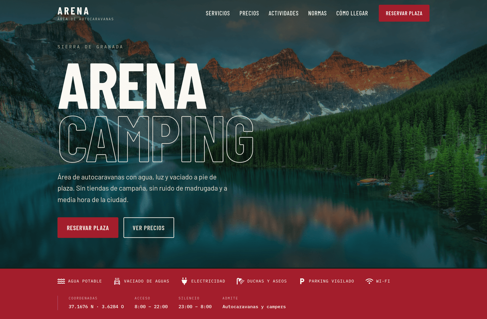
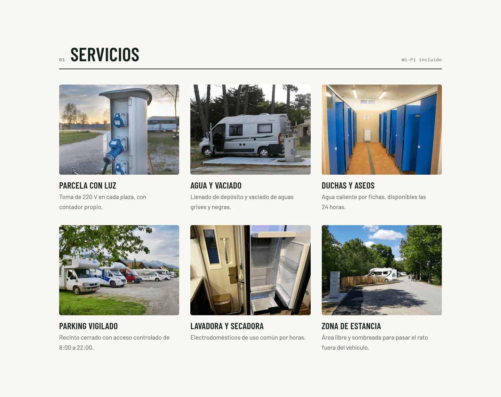
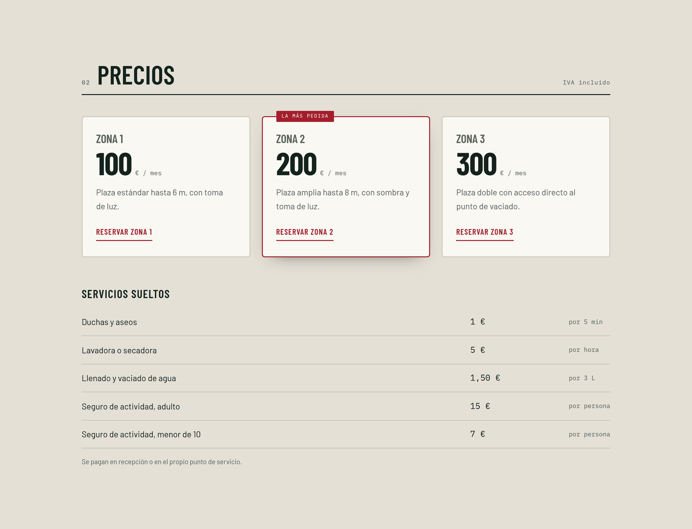
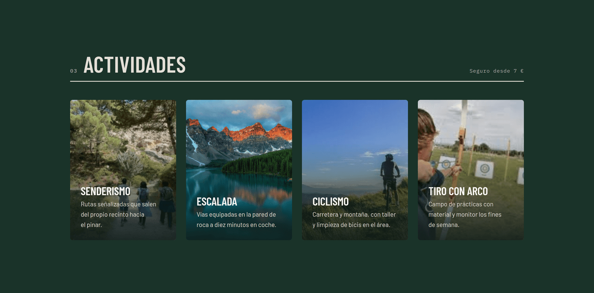
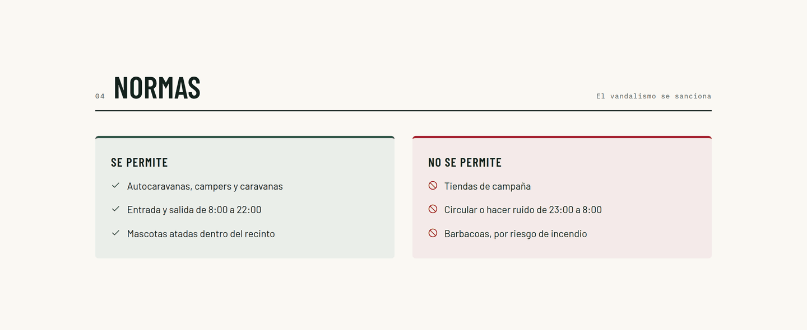
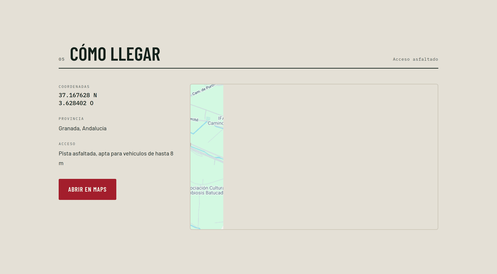
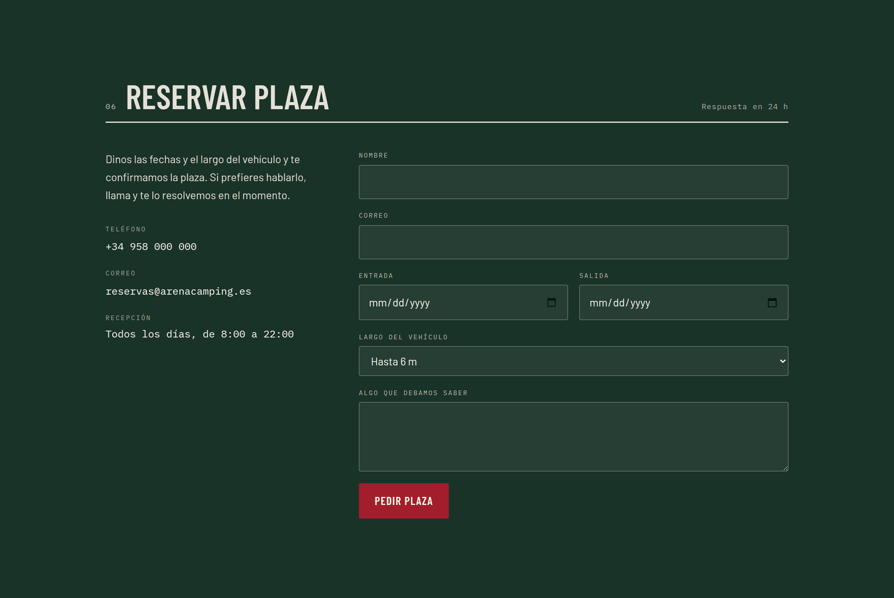
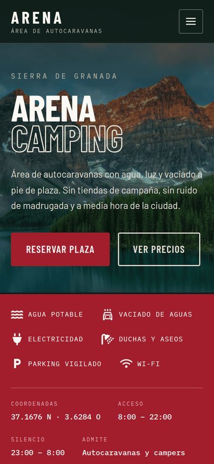

# Arena Camping

Web de un **área de autocaravanas** en la sierra de Granada. Una sola página que responde a lo que un autocaravanista comprueba antes de desviarse de la ruta: qué servicios hay, cuánto cuesta, qué está permitido y cómo llegar.



---

## Sobre el diseño

La página está planteada como **el panel informativo de un área de servicio**, no como un folleto de naturaleza. La banda roja bajo la portada reúne los seis servicios y los datos duros —coordenadas, horario de acceso y de silencio— porque es lo primero que se mira al llegar con el vehículo.

**Tres colores, ni uno más:**

| Color | | Papel |
|---|---|---|
| Pino | `#1a3329` | El pinar de la sierra al anochecer. Hace de negro |
| Piedra | `#e4e0d6` | Caliza de la sierra. Fondo claro y frío |
| Granada | `#a31e2c` | Único color saturado: acciones y banda de servicios |

El acento sale del escudo de la ciudad: **Granada es la fruta**, y por eso está en sus bolardos y en su bandera.

**Tipografía:** Barlow, nacida a partir de la señalética de infraestructura pública. La condensada hace de rótulo, la monoespaciada sostiene los datos.

---

## Capturas

### Servicios


### Precios


### Actividades


### Normas


### Cómo llegar


### Reservar


### Móvil


---

## Stack

- **React 18** sin router: una sola página con navegación por anclas
- **Vite 6** como empaquetador
- **CSS propio** con variables, sin framework de estilos
- **react-icons** para los pictogramas de servicio

Tres dependencias en total y cero vulnerabilidades.

## Instalación

```bash
npm install
```

## Uso

```bash
npm run dev
```

| Comando | Descripción |
|---|---|
| `npm run dev` | Servidor de desarrollo con recarga en caliente |
| `npm run build` | Genera la versión de producción en `build/` |
| `npm run preview` | Sirve en local la versión ya construida |

## Accesibilidad

- Contraste AA o AAA en todos los pares de color de la interfaz
- Navegación por teclado con foco visible y enlace para saltar al contenido
- Se respeta `prefers-reduced-motion`
- Menú móvil con `aria-expanded` y `aria-controls`

## Pendiente

- El teléfono y el correo son de ejemplo. Sustituir en `src/sections/Reservar.jsx`
- El formulario de reserva no envía a ningún sitio todavía: falta conectarlo a un backend o a un servicio de formularios
- Falta una foto propia de la vía de escalada; ahora se reutiliza el paisaje

## Créditos

Proyecto desarrollado durante el período de prácticas en Arena Gaming.

## Licencia

MIT
