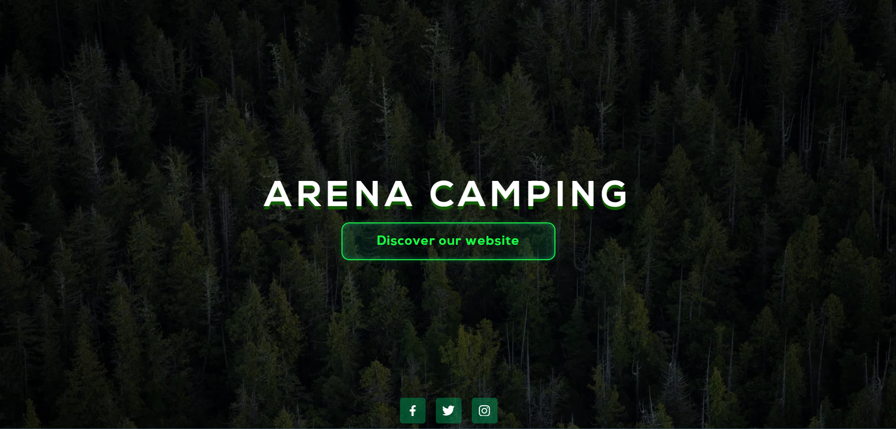
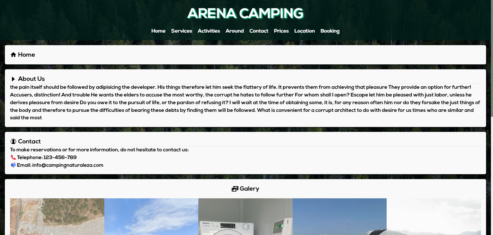
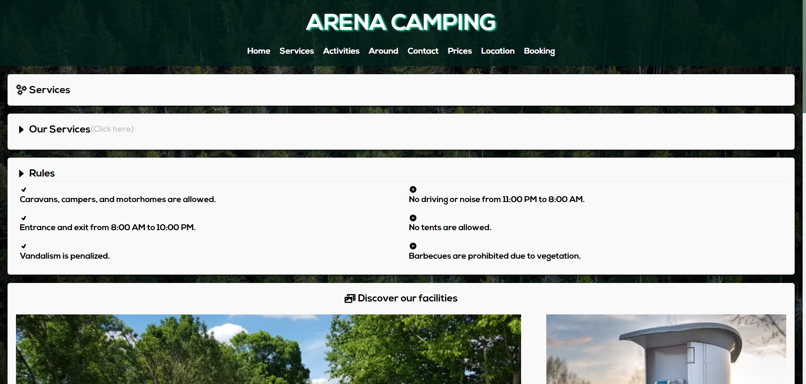
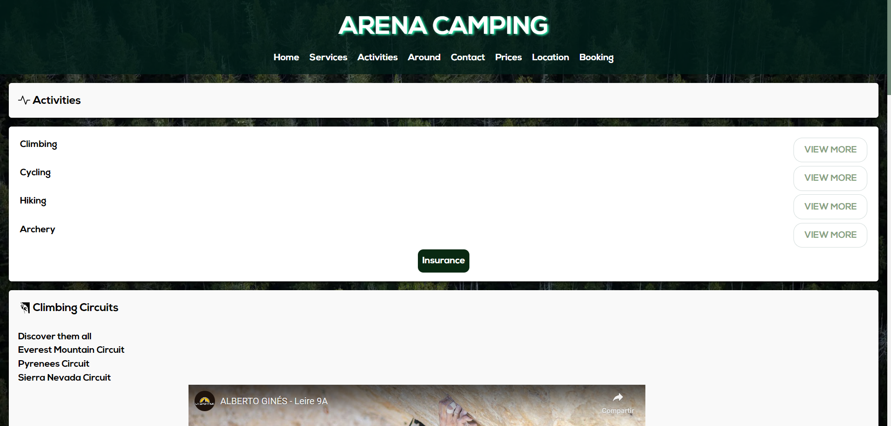
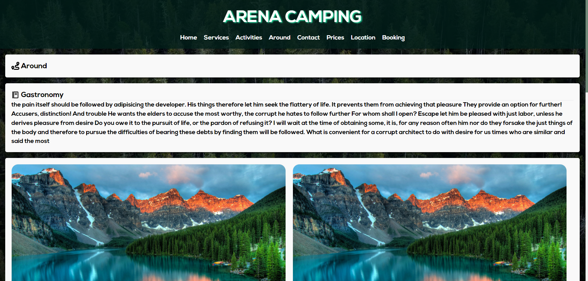
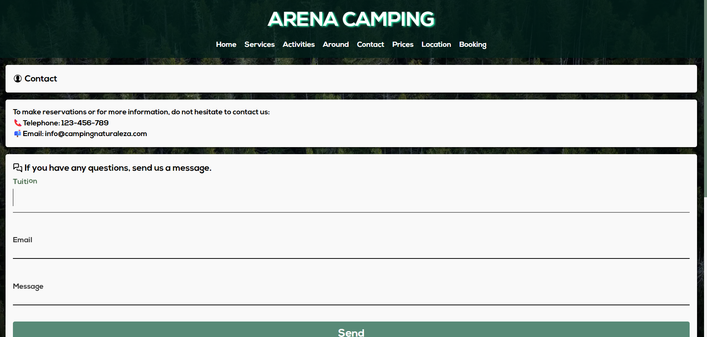
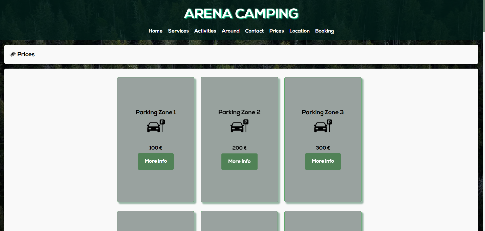
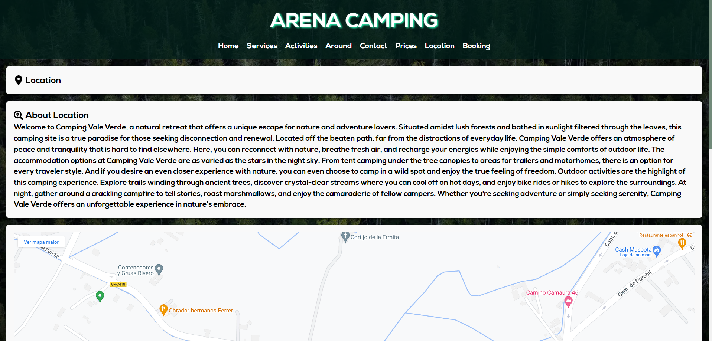
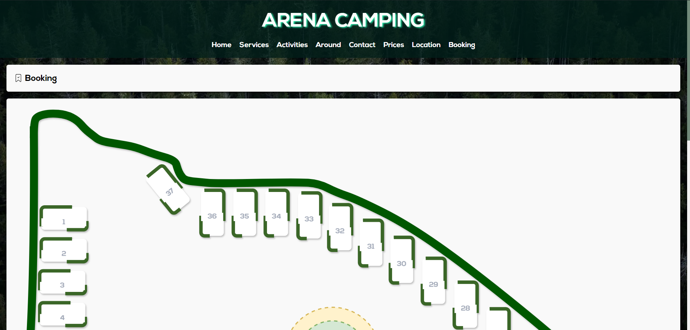
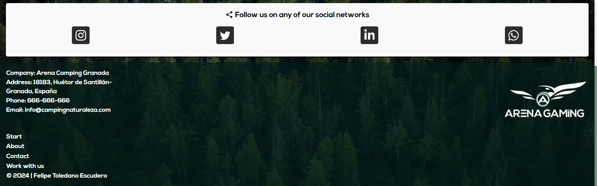

# <h1><center>ArenaCamping-Web</center></h1>


Este proyecto es una aplicación web desarrollada con React y empaquetada con Vite.

## Descripción

Esta aplicación web es el resultado del trabajo colaborativo de dos profesionales durante su período de prácticas en la empresa Arena Gaming. 

## Instalación

1. Clona este repositorio.
2. Instala las dependencias utilizando npm:

   ```bash
   npm install
   ```

## Uso

Para arrancar el servidor de desarrollo:

```bash
npm run dev
```

Esto iniciará Vite y podrás acceder a la aplicación desde tu navegador.

Otros comandos disponibles:

| Comando | Descripción |
|---|---|
| `npm run dev` | Servidor de desarrollo con recarga en caliente |
| `npm run build` | Genera la versión de producción en `build/` |
| `npm run preview` | Sirve en local la versión ya construida |

## Capturas de pantalla | Screenshots

A continuación, se muestran algunas capturas de pantalla de la aplicación:

### Home


### Inicio


### Servicios


### Actividades


### Around


### Contacto


### Precios


### Localización


### Reserva


### Footer


Para ver la pagina web puede acceder a nuesto enlace de GitHub Pages: 

## Contribución

Si quieres contribuir a este proyecto, ¡serás bienvenido! Puedes abrir un issue o enviar un pull request.

## Licencia

[MispeLicense]
